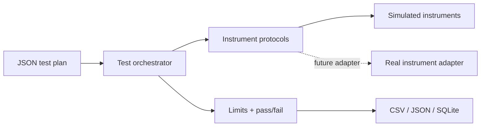

# Automated Hardware Testbench

A modular electronics test orchestrator that evaluates voltage, current, and frequency limits through instrument interfaces, with deterministic instrument simulation and reusable JSON plans.

## Problem and objectives

Bench testing becomes repeatable when test steps, tolerances, instrument access, and results are separated. This project defines small instrument protocols, applies explicit limits, stores history, and emits portable reports.

## Features

- Reusable JSON test plans and measurement result records.
- Simulated multimeter, supply, and oscilloscope behavior with configurable deterministic noise.
- Pass/fail evaluation by absolute tolerance, input validation, and supply shutdown in a `finally` path.
- CSV/JSON reports plus SQLite run and result history.
- Protocol interfaces for instrument replacement and a clearly unverified serial adapter boundary.
- CLI returns a failing exit status when any check fails.

## Architecture



Each test compares `abs(measured - expected) <= tolerance`. The test sequence depends on protocol methods rather than a specific manufacturer. The serial class deliberately stops at the adapter boundary: serial framing and SCPI commands are model-specific and cannot be assumed safely.

## Installation

Windows PowerShell: `py -3.11 -m venv .venv`, then `\.venv\Scripts\python.exe -m pip install -e ".[test]"`.

Linux/macOS: `python3 -m venv .venv`, activate it, then `python -m pip install -e '.[test]'`.

Optional serial library: install `python -m pip install -e '.[serial]'`.

## Usage

```powershell
hwtest examples/basic_test_plan.json --json reports/run.json --csv reports/run.csv
```

The sample plan sets a 5 V supply and checks rail voltage, load current, and oscillator frequency. Output files are generated locally and ignored by Git. Results identify their source as `simulated instruments`.

## Tests

Run `python scripts/run_tests.py` from an uninstalled checkout, or `python -m unittest discover -s tests -v` after installation. Six tests passed locally, covering tolerance pass/fail, plan execution and output disable, JSON/CSV export, plan validation, SQLite round trips, and CLI execution. No real instrument is required.

## Limitations and future work

Simulation is deterministic and intentionally simple; it does not model bandwidth, burden voltage, instrument calibration, relay safety, or device-specific command sets. Physical adapters, interlocks, calibration records, and safe-state behavior must be designed and verified per instrument before lab use.

All included runs use simulators. The serial adapter is only an interface boundary and has not been tested with physical hardware.
